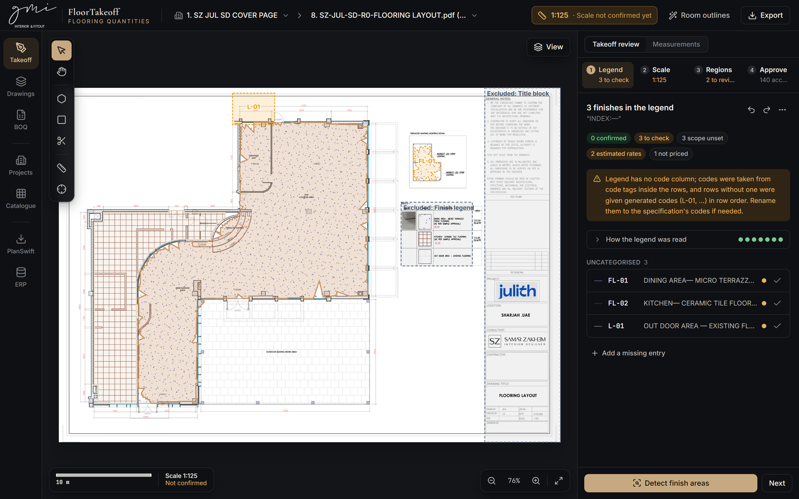
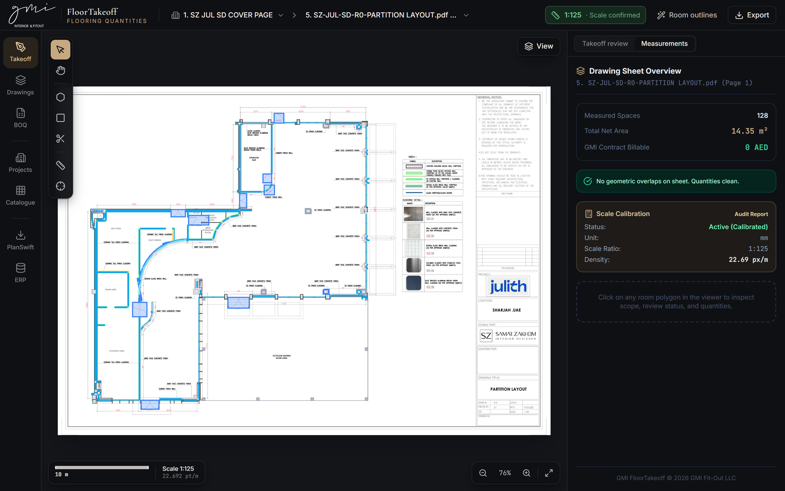
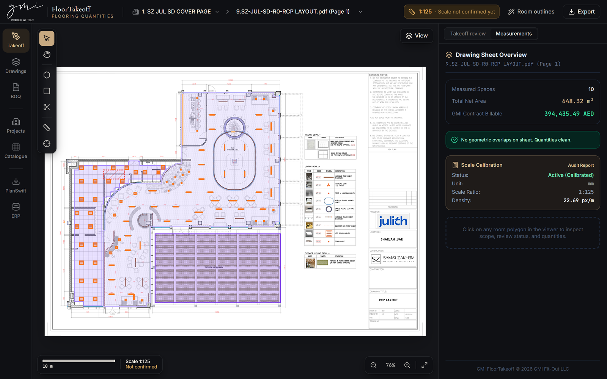
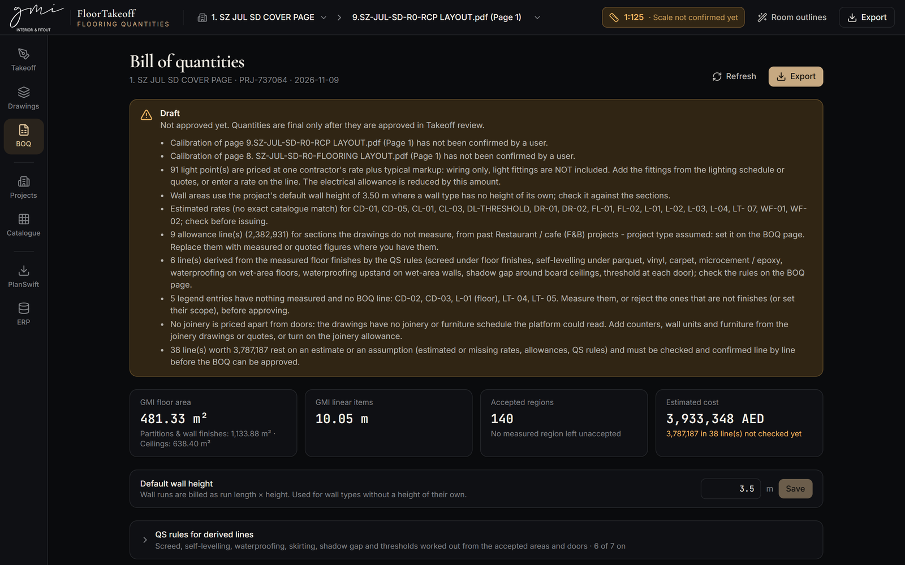
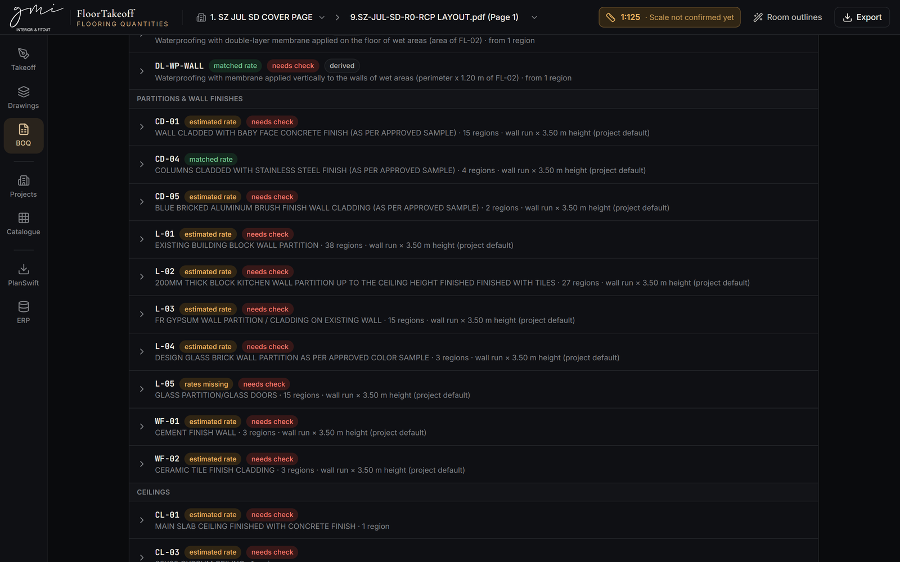

# GMI FloorTakeoff

Drawing takeoff and BOQ tool for GMI Design and Implementation LLC (Dubai).

FloorTakeoff reads fit-out drawings (PDF, image or DXF) as structured documents rather than pictures. It
interprets each sheet's own legend, finds where every finish or symbol occurs, measures it from the drawing
geometry, and calibrates from the figured dimensions. It then builds a priced bill of quantities.

Nothing reaches the BOQ on its own. Every quantity is offered for review, traces back to its source region,
legend entry and sheet, and the BOQ is approved by a person.

> **Status:** an assistant to the estimator, not a stand-alone estimator. It takes off what the drawings show
> and flags what it can't measure (missing schedules, unrated items, sheets it doesn't recognise). Results are
> compared with real QS BOQs in [`docs/validation/`](docs/validation/).

## What it reads

| Trade | From | Billed |
|---|---|---|
| Floor finishes | Finish legend, coloured or hatched fills, code tags | m², with derived screed, levelling and waterproofing |
| Skirting, thresholds, trims | Linear legend entries, door positions | m |
| Wall finishes | Plan-note leaders, finish tags, finish lines | m² by wall height, or m for linear items |
| Ceilings | RCP grid and pattern, shadow gaps | m² / m |
| Doors | Swing arcs | nr, priced by leaf type |
| Joinery | Item schedules | nr, priced from past item medians |
| Lighting | Symbols matched to the legend images | nr per fitting type, plus light points |
| Electrical | "Key to electrical symbols": sockets, twin sockets, isolators, switches | nr |
| Kitchen equipment | Equipment schedules | Listed as by others; grease traps go to plumbing |
| MEP, signage, preliminaries | Allowances per m² from past projects of the same type | Lump sum per section |

Exports: Excel, CSV and PDF, plus a QS-format workbook matching GMI's BOQ layout. The QS-format workbook can also
be compared line by line with an uploaded QS BOQ.

## Screenshots

**Floor finishes.** The sheet's own finish legend is read, each finish is traced on the plan, and the title
block and legend are excluded from measurement.



**Wall finishes and partitions.** Wall runs are assigned to their partition and cladding types from the
plan notes and finish tags.



**Ceilings and lighting.** Ceiling types are measured from the RCP, and light fittings are counted against
the sheet's lighting legend.



**Bill of quantities.** Every open issue is listed before approval, with totals by trade.



**BOQ lines.** Each line shows where its rate came from (matched, estimated or missing), whether it still needs
checking, and how its quantity was measured.



## Stack

- **Frontend:** React 19, TypeScript, Vite, Tailwind.
- **Backend:** FastAPI, SQLAlchemy with SQLite.
- **Drawings and geometry:** PyMuPDF for PDF vectors and rendering, Shapely for geometry, OpenCV and NumPy for hatches and raster sheets, ezdxf for DXF.
- **Exports:** openpyxl and ReportLab.
- **OCR:** Tesseract (optional), for scanned legends.

No external AI service is used. Classification and geometry are deterministic and covered by tests.

## Getting started

Requirements: Python 3.12 and Node.js 20 or later. Tesseract is optional.

```bash
py -3.12 -m pip install -r requirements.txt
```

```bash
npm install
```

Start the backend (http://localhost:8000, API docs at `/docs`):

```bash
py -3.12 run_local_backend.py
```

Start the frontend (http://localhost:5173):

```bash
npm run dev
```

On Windows, `start_gmi_floortakeoff.bat` starts both servers.

The backend reloads when its code changes. It works on the database in `backend/storage/`, so point
`GMI_STORAGE_DIR` at a copy when experimenting (see [Configuration](#configuration)).

## Using it

1. **Create a project** and upload its drawings: single PDFs, a multi-page set or a ZIP. Each sheet is analysed in the background, and uploading the same file twice is refused.
2. **Takeoff review**, for each sheet:
   - **Legend:** check the codes, descriptions and default scope that were read.
   - **Scale:** confirm the calibration proposed from figured dimensions, or calibrate manually.
   - **Regions:** accept, reject, edit, split or merge detected regions. Undo and redo are kept on the server.
   - **Approve:** approve the BOQ from accepted measurements.
3. **BOQ:** set rates, project type and allowances, compare with a QS BOQ, and export.

Approval is blocked while anything is open: sheets still being read, duplicate sheets, unconfirmed scales,
unreviewed regions, unchecked lines, unmeasured legend entries or unclassified scope. An estimator can still
**approve anyway** by giving a reason. The BOQ and every export then say "Approved with override", with the
reason and what was open. Two cases can't be overridden: sheets still being read and duplicate sheets, because
the quantities would be incomplete or doubled.

When measurements change after approval, the BOQ goes back to "Needs review".

## Configuration

All settings are environment variables; none are required for local use.

| Variable | Default | Purpose |
|---|---|---|
| `GMI_STORAGE_DIR` | `backend/storage` | Root for the database, drawings, renders, exports and backups |
| `DATABASE_URL` | SQLite file in the storage dir | SQLAlchemy URL |
| `GMI_AUTH_SECRET` | unset (open) | Enables sign-in through GMI ERP; it must match the ERP's `TAKEOFF_SHARED_SECRET`. It can also be set in `erp-link.env` |
| `GMI_WORKERS` | half the CPUs, 1–3 | Background analysis workers |
| `GMI_SYNC_JOBS` | `0` | `1` runs analysis inline (tests, scripts) |
| `GMI_SKIP_SEED` | `0` | `1` skips the sample data on start-up |
| `GMI_TESSERACT_CMD` | auto-detected | Path to `tesseract.exe` |
| `GMI_API_TARGET` | `http://127.0.0.1:8000` | Backend that the Vite dev server proxies to |

### ERP sign-in

With `GMI_AUTH_SECRET` set, every API call and stored file needs a token from GMI ERP. The token is an HS256
JWT with audience `gmi-takeoff`. Users open the tool from the ERP's Estimation screen. Without a secret the
tool runs open, which is meant for local development and tests only.

### Data safety

- **Before migrations:** start-up applies pending migrations from `migrations.py`, copying the SQLite file to `backups/` first.
- **Daily snapshot:** a snapshot is taken at start-up each day.
- **Deletes:** each delete snapshots the database first and moves files to `storage/trash` instead of erasing them.
- **Clear all:** clearing a project requires typing its name.

## Project layout

```
backend/
  app/
    main.py               FastAPI app, workers, start-up
    routes/               API: projects, drawings, takeoff, BOQ, exports, PlanSwift
    vector_extract.py     PDF fills, strokes and text in display space
    legend.py             legend detection and parsing (tables, header-less, OCR)
    calibration_engine.py scale from figured dimensions
    finish_detection.py   floor finishes from fills, hatches and tags
    wall_finishes.py      wall finishes from plan notes
    wall_tags.py          finish tags assigned to wall faces
    ceiling_detection.py  RCP ceilings
    doors.py              doors from swing arcs
    symbol_count.py       lighting symbols
    electrical.py         electrical symbol key
    joinery.py            joinery item schedules
    kitchen_equipment.py  kitchen equipment schedules
    quantities.py         BOQ generation, checks and approval gate
    allowances.py         allowance sections per m²
    qs_format.py          QS-format export and comparison
    data/                 rate libraries (JSON)
  tools/                  rate-library builders and validation scripts
  tests/                  backend tests (isolated storage)
src/                      React frontend
tests/frontend/           frontend tests
docs/                     rate libraries (xlsx), diagnosis and validation reports
  screenshots/            images used in this README
```

## Tests

```bash
npm run test:backend
```

```bash
npm run test:frontend
```

Type-check the frontend with:

```bash
npx tsc --noEmit -p tsconfig.app.json
```

Use `-p tsconfig.app.json`, because `-p .` checks nothing.

Backend tests always run against a temporary database and storage folder, never the live data. They use synthetic PDFs
with known answers: clip paths, holes, composite symbols, hatches, dashed lines, rotation, and legends in
different layouts. A few tests also use a reference drawing from local storage and are skipped when it isn't
present.

## Rate libraries

Rates come from GMI's past BOQs and contractor quotations. They are built by the scripts in `backend/tools/`:

| Library | Built by | Used from |
|---|---|---|
| Wall, ceiling and trim | `build_trade_rate_library.py` | the catalogue, loaded with `import_rate_library.py` |
| Joinery | `build_joinery_rates.py` | `backend/app/data/joinery_rates.json` |
| MEP | `build_mep_rates.py` | `backend/app/data/mep_rates.json` |
| Allowances | `build_allowance_rates.py` | `backend/app/data/allowance_rates.json` |

Each library also has a readable workbook in `docs/`. `import_rate_library.py` only adds new items to the
catalogue, unless `--update-existing` is passed.

> **Confidential.** Rate libraries, cost data and project drawings are GMI commercial information. Keep this
> repository private, and don't commit `backend/storage/`, `.env` or `erp-link.env`.

## Known limitations

- **Drawings it can't read yet:**
  - plumbing, HVAC, fire and gas layouts;
  - kitchen layout sheets without a schedule;
  - lighting sheets without a legend.
  These are listed as not used for the takeoff.
- **Missing joinery:** joinery is priced only when the drawings include an item schedule.
- **Hatch-only finishes have approximate edges.** Narrow concave corners need checking in review.
- **Scanned legends rely on Tesseract.** OCR text is always marked for review.
- **DWG is not read directly.** Export it to PDF (preferred, keeps vectors) or DXF.
- **Legacy code:** `gmi_floortakeoff_app.py` and the contour detector in `cv_engine.py` are older code, not part of the current pipeline.

More detail: [`docs/DIAGNOSIS.md`](docs/DIAGNOSIS.md), [`docs/VALIDATION_REPORT.md`](docs/VALIDATION_REPORT.md),
[`docs/validation/`](docs/validation/).
